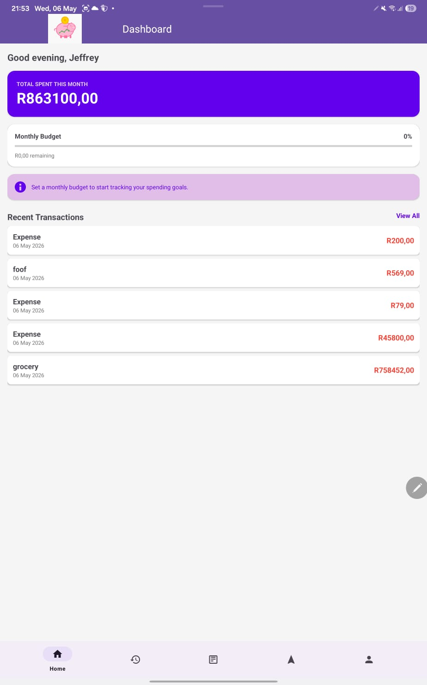
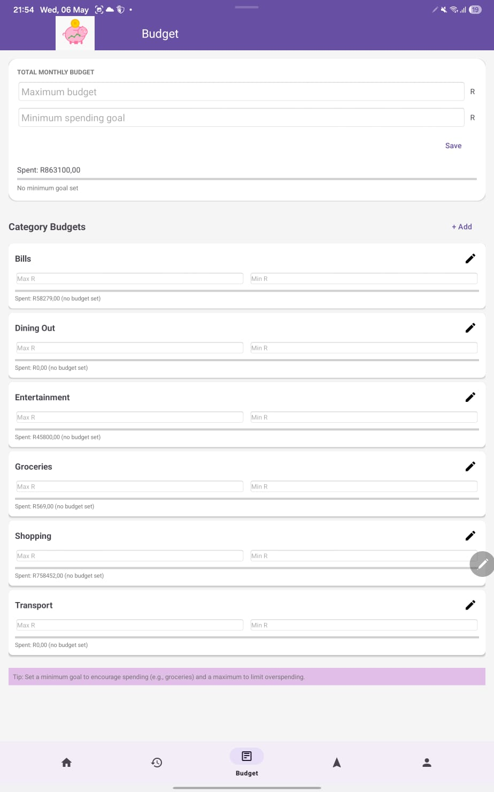
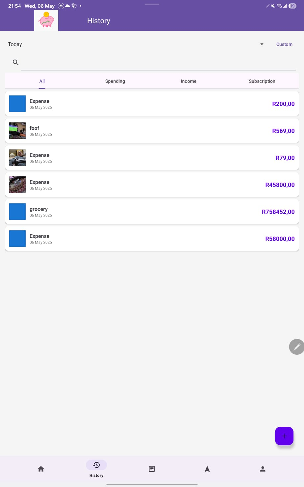
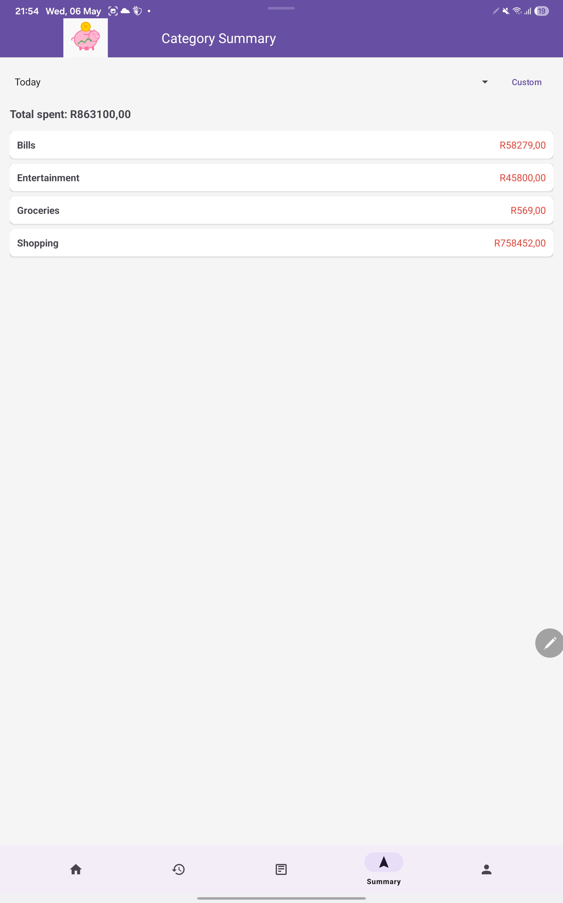

# SmartSpenda

SmartSpenda is a personal finance management application designed to help users track their expenses, manage budgets, and achieve financial goals through visualization and gamification.

Built as a group project (Group 3) with Kotlin, Room, MPAndroidChart and Material Design 3.

## Screenshots

| Dashboard | Budget | History | Category summary |
|---|---|---|---|
|  |  |  |  |

## Features

### Core Features
- **Expense Tracking**: Easily log expenses with categories, descriptions, and timestamps.
- **Budget Management**: Set monthly minimum and maximum spending goals for total spending or specific categories.
- **Visual Analytics**: View spending patterns through interactive bar charts showing category-wise distribution.
- **Goal Monitoring**: Dashboard visualization showing progress relative to minimum and maximum spending goals.
- **Gamification**: Earn badges like "Budget Master", "Consistent Logger", and "Smart Spender" based on your financial habits.

### Custom Features (For Lecturer Review)
1. **Receipt Image Capture**:
   - Users can take photos of their receipts or select them from the gallery when adding an expense.
   - Images are saved locally for future reference and record-keeping.
   - This feature helps in digitalizing physical receipts and improving tracking accuracy.

2. **AI-Powered Spending Insights**:
   - The application analyzes your current spending against your defined goals.
   - It provides dynamic "Smart Tips" on the dashboard, warning you if you are nearing your budget or encouraging you if you are meeting your savings goals.
   - This proactive feedback helps users make better financial decisions in real-time.

## Setup Instructions
1. Clone the repository.
2. Open the project in Android Studio (Iguana or newer recommended).
3. Ensure you have the `MPAndroidChart` library synced via Gradle.
4. Run the app on an Android device (Physical device recommended for camera features).

## Technologies Used
- **Kotlin**: Primary programming language.
- **Room Database**: For local data persistence.
- **MPAndroidChart**: For data visualization.
- **Material Design 3**: For a modern and professional UI.
- **ViewBinding**: For safe interaction with UI components.
